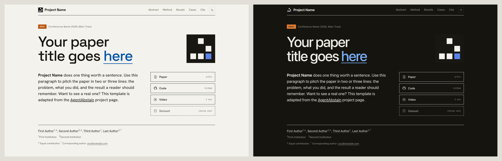
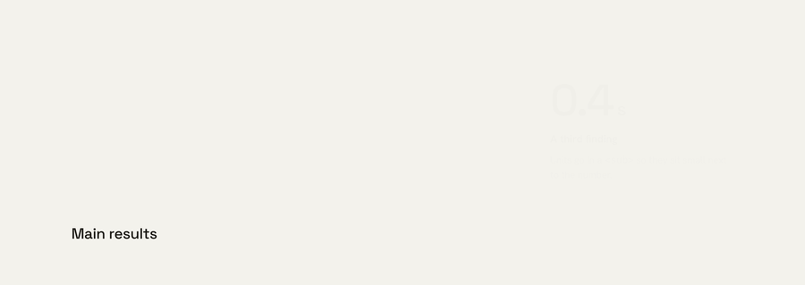
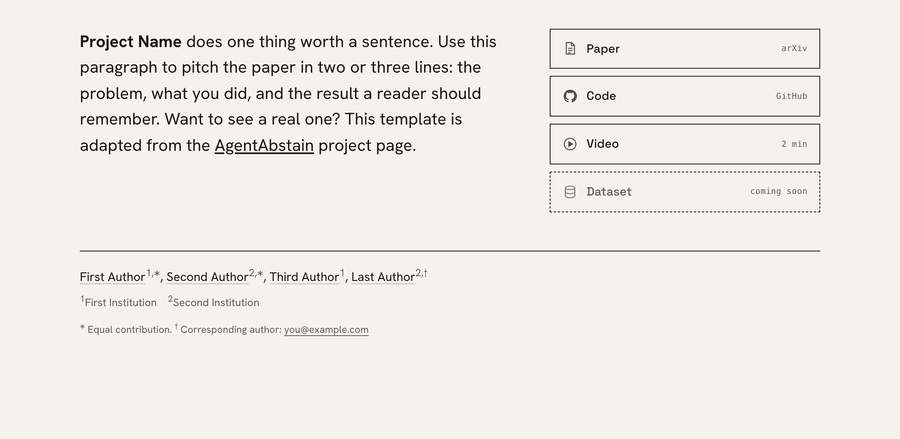
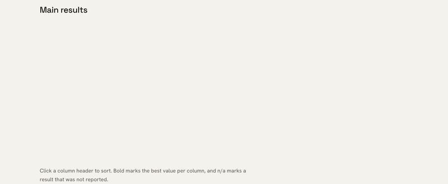
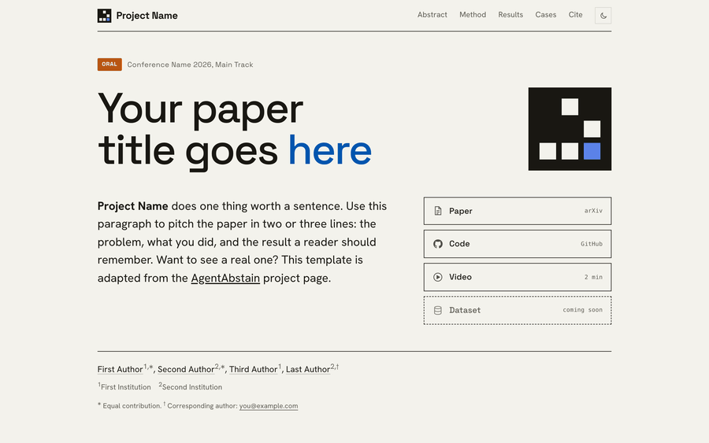
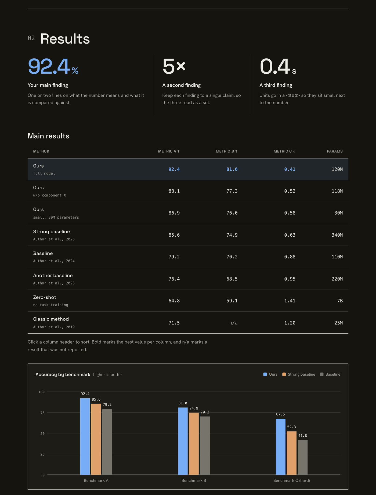
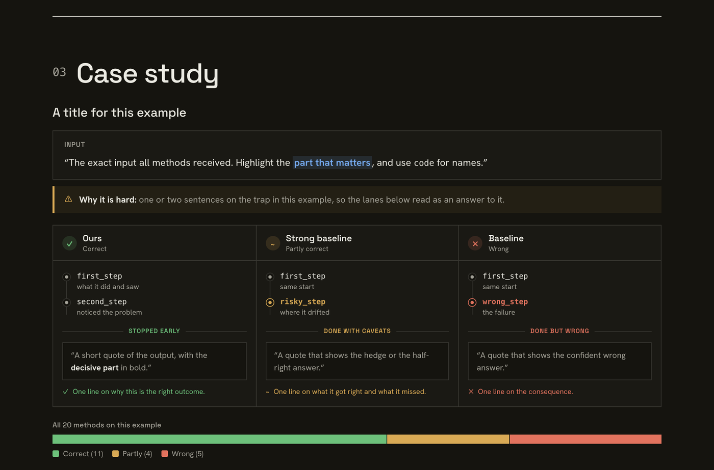
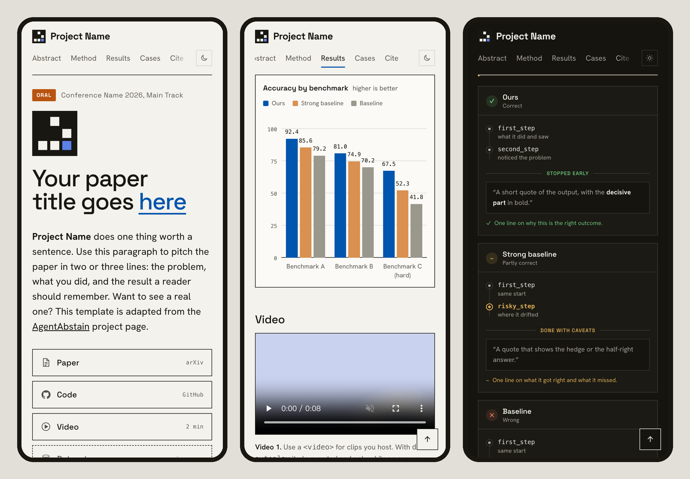
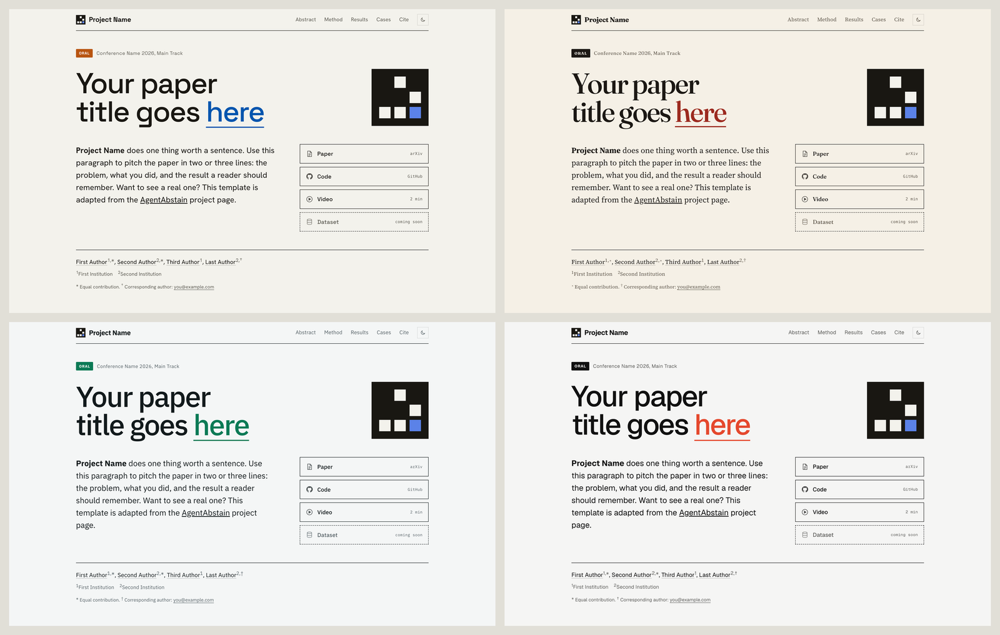

<div align="center">


# Masthead

**An academic project page template for research papers.**<br>
Plain HTML, CSS and JavaScript. No build step, no dependencies, and it runs on GitHub Pages as is.

[](LICENSE)
[](#quick-start)
[](#why-masthead)
[](#theme-presets)

**[Live demo](https://antiquality.github.io/masthead-project-page-template/)** &nbsp;&nbsp; **[Use this template](https://github.com/AntiQuality/masthead-project-page-template/generate)** &nbsp;&nbsp; **[Real example: AgentAbstain (NeurIPS 2026 Oral)](https://agentabstain.github.io)**


</div>

## Why Masthead



- **Looks like a front page, not a slide.** Big newspaper-style type, hairline rules and a paper-and-ink palette that puts your title first.
- **Light and dark mode built in.** It follows the reader's system setting, and a toggle in the top bar remembers their choice.
- **Results that read like results.** A sortable table, a bar chart drawn in plain HTML and CSS, three key numbers and a case study layout that compares methods step by step.
- **Fast and accessible.** Lighthouse scores 100 for performance, accessibility, best practices and SEO, on mobile and desktop. The whole page is about 17 KB gzipped before fonts and figures.
- **Ready for search and sharing.** Google Scholar `citation_*` tags, Open Graph and Twitter cards with a 1200 by 630 preview image, and schema.org structured data.
- **Easy to edit, by hand or with an AI agent.** Every block in `index.html` is a marked module you can copy or delete, and the [Masthead skill](skills/masthead/SKILL.md) lets your coding agent build the whole page from your paper.

## In motion

Motion is there to point at results, not to decorate. Everything below turns off for readers who prefer reduced motion.

**Bars grow in when the chart scrolls into view, and hovering a legend entry focuses one series.**



**Headline numbers count up the first time the stats strip appears.**



**Click any column header to sort the results table.**



**One click switches between light and dark mode, and the choice is remembered.**



## How it compares

| | Masthead | Nerfies-style templates |
|---|---|---|
| Dependencies | None (Google Fonts only) | Bulma, jQuery, Font Awesome, carousel plugins |
| Dark mode | Yes, with a toggle | No |
| Sortable results table | Yes | No |
| Charts | Built in, HTML and CSS | Images only |
| Case study and comparison layouts | Yes | No |
| Theme presets | 4 | No |
| License | MIT | CC BY-SA 4.0 |

Nerfies and its descendants are great templates and inspired a whole generation of project pages. Masthead takes a different look and leans on modern CSS instead of libraries.

## Quick start

### With an AI agent

Install the Masthead skill, then ask your agent for a project page:

```bash
npx skills add AntiQuality/masthead-project-page-template
```

> Make a project page for my paper with Masthead.

The agent reads your paper, shows you an outline, asks a few design questions (title highlight, modules, theme, preview image), then builds the page, checks it in light mode, dark mode and on phones, and publishes it to GitHub Pages when you say so. The skill works with Claude Code, Codex, Cursor, Gemini CLI and other agents that support [Agent Skills](https://agentskills.io).

### By hand

1. Click **Use this template** (or fork or download this repo).
2. Edit `index.html`. Every block is marked with a `MODULE` comment, so delete what you don't need.
3. Change colors and fonts in `assets/css/tokens.css`. Light and dark mode are both defined there.
4. Replace the placeholder figures, video and `social-preview.png` in `assets/media/`.
5. Turn on GitHub Pages for the repo: in Settings, open Pages and deploy from `main`.

To preview locally, run `python3 -m http.server` in the repo folder and open `http://localhost:8000`. Before publishing, `python3 skills/masthead/scripts/check_page.py index.html` lists leftover placeholders, broken section links and other common slips.

## Modules

| Module | What it shows | Main class |
|---|---|---|
| Top bar | Project name, section links that follow the scroll, dark mode toggle | `.top` |
| Hero | Venue badge, title with an accent word, pitch, resource buttons, authors | `.hero` |
| Abstract | A one-line hook next to the abstract | `.abstract` |
| Stats strip | Three to six headline numbers that count up on scroll | `.stats` |
| Figure | Wide figure, video or YouTube embed, side-by-side panels | `.fig`, `.fig-row`, `.embed` |
| Comparison cards | Two inputs and the one change between them | `.pair` |
| Key results | Three big numbers with a line of context each | `.keys` |
| Results table | Sortable columns, highlighted best row, citations under method names | `.tbl` |
| Bar chart | Grouped bars, legend, hover to focus a series | `.chart` |
| Case study | The input, why it is hard, one lane per method, an outcome bar | `.case` |
| Callout | One takeaway sentence | `.callout` |
| Cite | BibTeX with a copy button | `.citebox` |





## Mobile

The navigation turns into one swipeable row that follows the section in view, cards and lanes stack, and charts and tables fit or scroll on their own.



## Theme presets

`tokens.css` is the default look. For a different one, add a preset after it in `<head>`:

```html
<link rel="stylesheet" href="assets/css/themes/gazette.css">
```

| Preset | Fonts | Accent |
|---|---|---|
| default | Space Grotesk, Hanken Grotesk | blue |
| `gazette` | Fraunces, Source Serif 4 | oxblood |
| `lab` | IBM Plex Sans, IBM Plex Mono | green |
| `mono` | Geist, Geist Mono | vermilion |

Each preset loads its own fonts and defines both light and dark mode. Preview any of them on the demo page with `?theme=`, for example `index.html?theme=gazette`.



## Customizing

- **Colors and fonts.** Everything lives in CSS variables in `assets/css/tokens.css`: paper and ink, the accent, the venue badge, status colors and four chart series colors.
- **Width.** Change `--maxw` in `tokens.css`.
- **Motion.** Scroll reveals, counting numbers and growing bars turn off for readers who prefer reduced motion. Add `?static` to the URL to see the page without them.
- **No JavaScript.** Nothing is hidden without JS. Sorting, the theme toggle and animations simply do not run.

## Working with an AI agent

Already have the template? [`AGENTS.md`](AGENTS.md) is the rulebook any coding agent can follow: which files to edit, how each module works and the text style. The skill in [`skills/masthead`](skills/masthead/SKILL.md) uses it too.

## Showcase

Pages in the Masthead style:

| Project | Venue |
|---|---|
| [AgentAbstain: Do LLM Agents Know When Not to Act?](https://agentabstain.github.io) | NeurIPS 2026 Oral, Evaluations and Datasets Track |

Masthead is adapted from the AgentAbstain project page and generalized into a reusable template. Built a page with Masthead? Open a pull request to add it here.

## Acknowledgments

Masthead grew out of the [AgentAbstain](https://agentabstain.github.io) project page. [Vira Kasprova](https://www.linkedin.com/in/vira-kasprova/) built the first version, and [Xun Liu](https://antiquality.github.io/) iterated on it into this template. Thanks to the whole AgentAbstain team for their feedback.

## License

[MIT](LICENSE). You are free to use Masthead for any project. A link back to this repo in your footer is appreciated.
